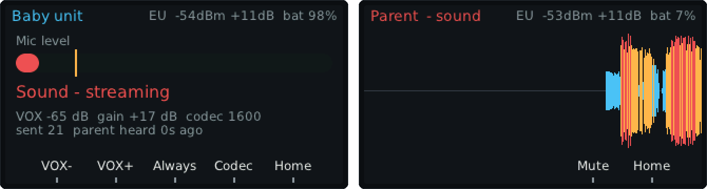
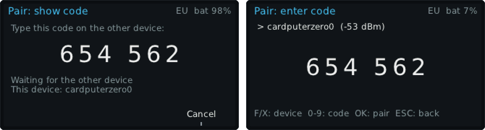
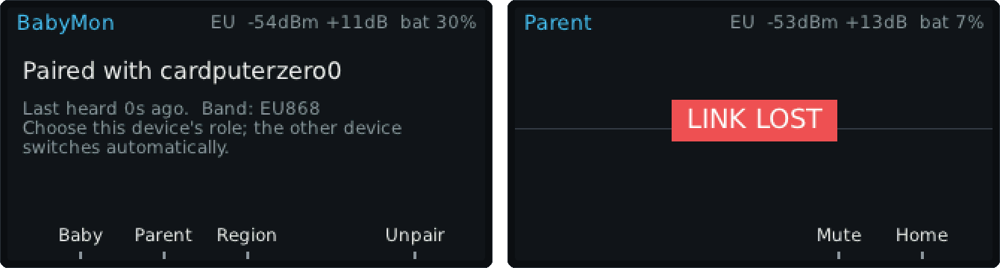

# cpz-baby-monitor (BabyMon)

A baby monitor for two M5Stack **CardputerZero** devices fitted with the **Cap LoRa-1262**. It needs no Wi-Fi or phone.

- **Pairing:** one device shows a 6-digit code and you type it on the other. A CPace-style PAKE on ristretto255 (libsodium) turns the code into a shared link key, so the code cannot be brute-forced offline from captured radio traffic.
- **Roles:** choose *Baby* or *Parent* on either device and the other one switches to the opposite role.
- **Audio:** the Baby unit compresses sound with **Codec2 1600** (8 kHz) and sends it encrypted (ChaCha20-Poly1305) over LoRa while it hears something (VOX gate). The Parent unit plays it and draws a scrolling waveform.
- **Link loss:** the Parent shows *LINK LOST* after 10 s without a packet. The Baby sends a heartbeat every 2 s while quiet.

## Screens

### Monitoring

The Baby unit (left) watches the mic level and streams as soon as sound crosses its VOX threshold. The Parent unit (right) decodes the audio, plays it on its speaker and draws a scrolling waveform: quiet noise in blue, loud sound in orange/red.



### Pairing

Press **4** on one device to show a 6-digit code, **5** on the other to pick it from the list of discovered devices and type the code. Both then store a shared link key, and the last used roles are restored on the next start.



### Home and link loss

The Home screen shows the paired device, the band in use, and the role buttons (choosing a role switches the other device automatically). If the Parent stops hearing the Baby for 10 s, it covers the waveform with a *LINK LOST* banner.



## Radio

Two bands; press **6 (Region)** on the Home screen to switch. The choice is saved per device in `~/.config/cpz-baby-monitor/region.txt`. When paired, the device sends the request to its peer on the current band and both retune. When unpaired, only the local device switches, so set both to the same band before pairing.

| Band | Frequency | Modulation | Airtime per 320 ms packet | Channel busy while streaming |
| --- | --- | --- | --- | --- |
| US915 (default) | 915.0 MHz | BW500 SF9 CR4/5, +22 dBm | 123 ms | ~38% |
| EU868 | 869.525 MHz (869.4–869.65 sub-band) | BW250 SF7 CR4/5, +22 dBm | 77 ms | ~25% |

US915: FCC 15.247 treats 500 kHz LoRa as wideband, so there is no dwell-time limit. EU868: this sub-band allows 500 mW ERP but only a **10% duty cycle**. Streaming exceeds that, so this is acceptable for private testing only and not for distribution. EU868 SF7/BW250 is about 2.5 dB less sensitive than US915 SF9/BW500. Profiles are defined in `src/radio/radio_config.hpp`.

## Keys

| Screen | 4 | 5 | 6 | 7 | 8 / ESC |
| --- | --- | --- | --- | --- | --- |
| Home, unpaired | Show code | Enter code | Region | | Quit |
| Home, paired | Baby | Parent | Region (both devices) | | Unpair (ESC quits) |
| Baby | VOX −3 dB | VOX +3 dB | Always stream | Codec 1600 / 700C | Home |
| Parent | | | | Mute | Home |

Code entry: F/X picks a device, 0–9 types the code, OK pairs, ESC goes back.

Key **9** turns the Wi-Fi radio off and on from any screen (a toast confirms the change). System volume works as usual — fn+S / fn+D to change it, fn+A to mute — and the app plays a short confirmation tone after each press; see [Power](#power).

## Codec

The Baby encodes with Codec2 **1600** by default. Key 7 on the Baby screen switches to **700C**, the range fallback. 700C is lower quality, but each 320 ms packet is 28% shorter on air: 92 → 56 ms on EU868, 128 → 92 ms on US915. That leaves more room for retries on a weak link. The choice is saved per device in `codec.txt`. The Parent follows automatically: every audio packet carries its codec mode, and a mode change starts a new stream, so the Parent's jitter buffer resynchronises.

## Power

A monitor is meant to run for hours on the battery, so the app switches off what nobody is looking at. Measured on a CardputerZero with the app running, on battery (median of 30 one-second samples of `/sys/class/power_supply/bq27220-0/current_now`):

| State | Draw | Saving |
| --- | --- | --- |
| Screen at 75%, Wi-Fi on | 437 mA ≈ 1.76 W | — |
| Screen off (backlight 0) | 392 mA ≈ 1.58 W | 45 mA ≈ 180 mW |
| Wi-Fi off, screen at 75% | 407 mA ≈ 1.64 W | 36 mA ≈ 145 mW |

- **Screen off.** After 30 s without a key press the backlight is set to 0 and the app stops drawing. The radio and audio threads keep running, so the Parent keeps playing and the Baby keeps streaming. Any key lights the screen again (that press is consumed, it does not also act); media keys — volume, mute, brightness — never wake it. If the launcher's own `DarkTime` darkens the panel first, the app adopts that state rather than fighting it, and it follows the backlight once a second so the screen state is always what the hardware says. `CPZBM_SCREEN_OFF_SECONDS` changes the timeout (default 30, `0` = never) and `CPZBM_BACKLIGHT` points at a different `backlight` sysfs directory.
- **Wi-Fi off.** Key 9 switches the Wi-Fi radio off while monitoring: an idle associated radio plus Tailscale costs ~145 mW, the largest saving after the backlight. The app turns it back on when it exits, and a toast reports the change once the switch really happened. A detached user service (`cpzbm-wifi-guard`) watches the app and restores the radio if it is killed, so a crash cannot leave the device unreachable. A hard power cut while the radio is off still needs Wi-Fi re-enabled from Settings after the next boot.
- **USB bus.** The internal USB Ethernet chip (SR9900A) has no cable in most setups, yet it keeps the whole USB bus awake at ~8000 interrupts/s. The package's udev rule lets it runtime-suspend (`power/control=auto`): with nothing in the RJ45 port the bus sleeps and the board draws roughly 105 mA less (a community measurement on the same board; the bus staying suspended at ~27 interrupts/s is verified here). Plugging in a cable or a USB device wakes it as usual.
- **Low battery.** When the charger is not connected and the gauge reports 8% or less twice in a row (30 s apart), the app restores the LEDs, backlight and Wi-Fi and runs `systemctl poweroff` rather than dying mid-stream. It never fires while charging. `CPZBM_LOW_BATTERY_PERCENT` changes the threshold (`0` disables it).
- **Status LEDs.** The activity LED (`/sys/class/leds/ACT`, a plain on/off GPIO) and the power LED (`/sys/class/leds/default-on`, on an M5IOE1 PWM channel) are far too bright in a dark room. While the app runs the activity LED is switched off and the power LED is left at 10% — faint but still visible — and both are restored when it exits. The package ships a udev rule that lets the desktop user (group `gpio`) write them. `CPZBM_LED_POWER_PERCENT` changes the level (`0` = fully off, `100` = full) and `CPZBM_LEDS=off` leaves the LEDs alone.
- **Volume.** fn+S / fn+D / fn+A keep working as before (the compositor and `wf-panel-pi` handle them). Because our UI covers the panel's volume OSD, the app adds a 25 ms tone at the current volume: 990 Hz up, 660 Hz down, 440 Hz mute. It plays through its own short-lived stream, so it works on the Baby unit too and mixes over the Parent's audio without touching the jitter buffer. The app never grabs the keyboard, which is what keeps these keys alive.

## Build

Builds run in a Debian trixie container that matches the device OS: arm64 cross toolchain, plus multiarch `libcodec2-dev` and `libsodium-dev`.

```bash
scripts/fetch_deps.sh                 # pinned lvgl, RadioLib, pigweed, spdlog, miniaudio
scripts/remote_build.sh test          # host unit tests (ctest)
scripts/remote_build.sh all           # tests + arm64 binary + dist/*.deb
scripts/deploy.sh 100.104.185.112 100.100.188.11
```

`remote_build.sh` rsyncs the source to the Docker host (`CPZBM_BUILD_HOST`, default `192.168.1.60`) and runs the build there.

## Releases and CI

Package builds are automated by [`.github/workflows/release.yml`](.github/workflows/release.yml). Publish a GitHub release tagged **`vX.Y.Z`** and the workflow:

1. runs the host unit tests,
2. cross-builds the arm64 binary in the same Debian trixie image used locally,
3. builds `cpz-baby-monitor_X.Y.Z-1_arm64.deb`, stamped with the tag as its version,
4. attaches the `.deb` and its `SHA256SUMS` to the release.

Only **published** releases trigger it: drafts don't, and neither do releases created by another workflow with `GITHUB_TOKEN` (GitHub does not raise events for `GITHUB_TOKEN`). Publish from the Releases UI or with `gh release create` using your own token.

To check a build without cutting a release, run the workflow manually (**Actions → release → Run workflow**); it uploads the `.deb` as a build artifact and touches no release.

### Install a released package

```bash
scp cpz-baby-monitor_X.Y.Z-1_arm64.deb root@cardputerzero0:/tmp/
ssh root@cardputerzero0 'dpkg -i /tmp/cpz-baby-monitor_*.deb'
ssh root@cardputerzero0 'su louisremi -c "XDG_RUNTIME_DIR=/run/user/1000 systemctl --user restart APPLaunch.service"'
```

`dpkg -i` fails if a dependency is missing; `apt install -f` fixes that up. The desktop entry appears in the launcher as **BabyMon**.

## Headless diagnostics (over SSH, as the desktop user)

Close BabyMon and the stock LoRa app first: only one process can own the radio.

```bash
B=/usr/share/cpz-baby-monitor/bin/cpz-baby-monitor
$B --radio-listen        # on device 1 (echoes pings)
$B --radio-ping 20       # on device 2: RTT, RSSI/SNR both ways
# prefix both with CPZBM_PROFILE=eu to test the EU868 profile
$B --mic-test 10         # mic level meter (needs XDG_RUNTIME_DIR for pipewire-pulse)
$B --codec-loop 15       # mic -> codec2 -> speaker
$B --bench-codec
$B --screen-test         # backlight off/on cycle, then restore
$B --beep-test           # the three volume-key tones
$B --wifi-test 10        # Wi-Fi radio off for 10 s, then back on
$B --led-test 5          # night mode for the status LEDs, then restore
```

`tools/e2e_driver.py` drives the real app on a device through a virtual uinput keyboard and takes framebuffer screenshots; it is used for automated end-to-end checks.

The raw 320×170 captures live in `store/screenshots/` (they are also the App Store assets). `python3 tools/make_readme_images.py` rebuilds the bezelled composites in `docs/images/` used above, so refreshing the screenshots only takes new captures from the devices.

## Layout

```
src/proto/   wire format, PAKE + AEAD, link state machine, band-switch handshake   (host-tested)
src/audio/   codec2 wrapper, VOX/AGC/jitter buffer, miniaudio I/O
src/radio/   radio thread + SX1262 bring-up forked from CardputerZero/Cap-LoRa-1262
src/store/   ~/.config/cpz-baby-monitor/{identity,pairing}.bin (0600, atomic writes)
src/power/   backlight, status LEDs and the screen idle policy
src/net/     Wi-Fi radio switch and its crash guard
src/ui/      320x170 LVGL screens; DejaVu Sans loaded at runtime (Montserrat fallback)
src/app/     controller (role pipelines) and debug modes
```

## Known limitations (v0)

- The built-in mic is quiet (about −84 dBFS in a quiet room). A software AGC of up to +40 dB and a −65 dBFS VOX default compensate, but the VOX threshold may need tuning on site.
- The app runs in the foreground only. The screen goes dark after 30 s without a key press; there is no gradual dimming, and only the backlight is cut (the panel controller stays powered). Turning Wi-Fi off is a saving while the app runs, not a persisted setting.
- Not intended for store submission (see `PUBLISH.md`): the EU868 profile exceeds the sub-band's 10% duty cycle while streaming.
